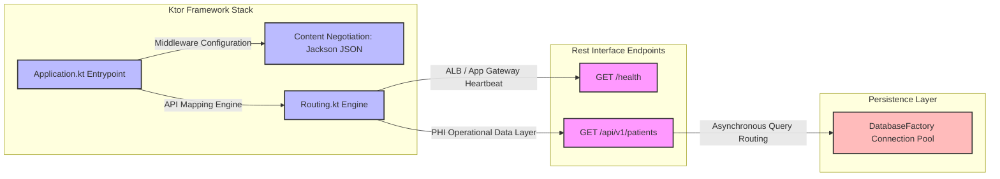

# Asynchronous Healthcare Clinical Registry Microservice

A high-performance, asynchronous Kotlin microservice engineered using the **Ktor** framework and **JetBrains Exposed ORM**. Built explicitly for cloud-native deployment, this service handles secure health record data flows while maintaining an optimized runtime footprint.

## Structural Blueprint

## Architectural Highlights

*   **Asynchronous Engine Design:** Built natively on Ktor and Netty, leveraging Kotlin coroutines to facilitate high-throughput, non-blocking asynchronous I/O performance.
*   **Infrastructure Target Parity:** Features a standalone `/health` endpoint structured specifically to hook into automated health probes executed by Application Load Balancers (ALBs) or Azure Application Gateways.
*   **Decoupled Persistence Modeling:** Implements a data access pattern using JetBrains Exposed, separating active connection management from operational business rules.
*   **Cloud-Native Environments Configuration:** Employs HOCON (`application.conf`) architecture, pulling data sources and endpoint credentials directly from secure runtime environment configurations (`JDBC_DATABASE_URL`).

## Technical Stack
*   **Language:** Kotlin (JVM 1.9.20+)
*   **Core Framework:** Ktor Server (Netty engine baseline)
*   **Serialization Middleware:** Jackson Core JSON Content Negotiation
*   **Persistence Mapper:** JetBrains Exposed Core + DAO Runtime
*   **Database Connectivity:** PostgreSQL Native JDBC Driver Component